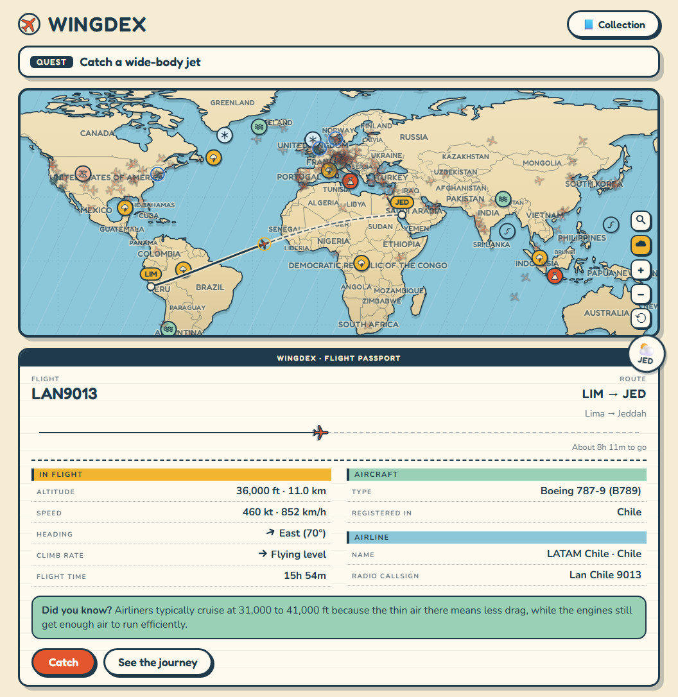
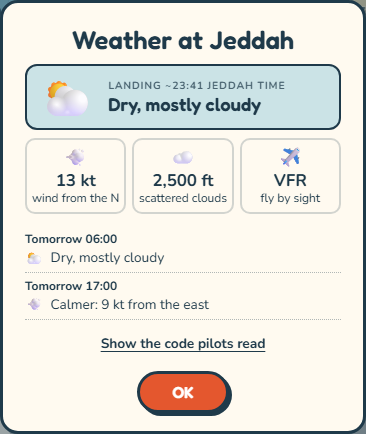
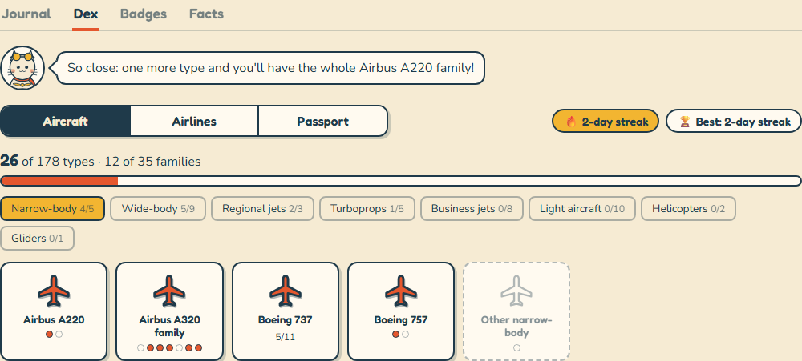
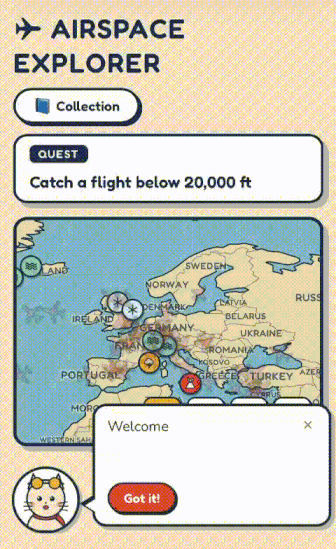

# Wingdex

**Spot planes. Catch them. Earn your wings.**

A "spot & collect" game built on real flight traffic. Watch planes cross a hand-drawn world map,
open one's flight passport, catch it for your collection, and pick up a bit of aviation along the
way. It runs on mock data out of the box; live flights are optional (see the data terms below).



## What you can do

- **Spot.** Planes glide across a world map in a retro travel-poster style, each drawn by its kind
  (airliners, business jets, light aircraft, helicopters, gliders), with weather hazards (storms,
  turbulence, icing, volcanic ash) as stickers. The map's colours follow the time of day where you
  look, and a few rare planes get a blue ring.
- **Open a flight passport.** Tap a plane for its card: route and cities, how far along it is and
  the time left, altitude, speed, heading and climb in plain words with their aviation units, the
  aircraft type and airline, and one "Did you know?" fact picked for that flight. Its sticker opens
  the destination's real forecast (TAF): a weather-app summary in the destination's own time, and
  turned over, the code pilots read, word by word.

<p align="center">
  
</p>

- **Catch.** Catch a plane into your Journal (once per flight each day) and replay its journey on
  the map.
- **Daily quest.** One quest a day on your own clock ("Catch a wide-body jet", "Catch a flight in a
  thunderstorm area"), with a short lesson when you finish it, and a streak to keep.
- **Collection.** The Journal; a Dex of the 178 aircraft types, 35 families, 80 airlines and the
  countries you've collected passport stamps from; 16 badges; and every fact you've learned.

<p align="center">
  
</p>

- **A cat pilot.** The mascot shows you around the first time, then says a word on special
  catches (a new badge and why, your first glider…), points at the quest's plane after a while and
  flies the map to it, and gives each Collection tab a next goal.
- **Find a flight.** Know someone on MU640? The 🔍 looks it up by flight number or callsign, even
  among the planes too crowded to draw, and flies you there.

Status: the app runs locally with mock or live data. Deployment is postponed: live OpenSky data
needs a written agreement for public use (see the data terms below), and hosting costs money.
`docs/plan.md` has the scope and roadmap, and `docs/history.md` how it was built.

## How it works

- **`backend/`: Python + FastAPI, world data only.** It serves `/flights`, `/weather`,
  `/flights/{id}/route` (a tapped flight's route), `/callsigns/{query}` (the flight search),
  `/airports/{icao}/taf` (a forecast) and `/health`. Flights come from built-in mock data or
  OpenSky, weather from mock data or the Aviation Weather Center. Each live feed is one shared,
  cached snapshot, so any number of players cost one upstream request per refresh. Routes and
  flight numbers are looked up from adsbdb and kept in memory only.
- **`frontend/`: React + TypeScript + Vite.** It polls flights every 5 s (paused while the tab is
  hidden) and weather every 5 minutes. The map uses no map library: its projection, pan and zoom
  are hand-written, and the coastlines and borders are Natural Earth data drawn as SVG. Planes
  glide between polls, and at most 800 are drawn in view (300 on touch screens). `src/` is grouped by feature (`map/`, `card/`,
  `collection/`, `quest/`, `mascot/`, `search/`, `onboarding/`, `data/`), with `shared-ui/` and
  `shared-lib/` for what several features use, `content/` for the facts and catalogs, and `styles/`
  for the stylesheets. Tests sit next to the code they test.
- **Game state stays in your browser.** The Journal, badges and today's quest are saved in local
  storage. Facts, quests and badges are worked out from a flight's own data: aircraft type, airline,
  altitude, climb, region, time of day and the weather it is in. The content (130 facts, the type
  and airline catalogs) is plain JSON in `frontend/src/content/`.

## Setup

You need Python 3.11+ for the backend and Node 22.22.2+ (or 24.15+) for the frontend.

Windows (PowerShell):

```powershell
cd backend
py -3.13 -m venv .venv
.venv\Scripts\python -m pip install -e ".[dev]"

cd ..\frontend
npm install
```

macOS / Linux:

```sh
cd backend
python3 -m venv .venv
.venv/bin/python -m pip install -e ".[dev]"

cd ../frontend
npm install
```

## Run (two terminals)

Windows (PowerShell):

```powershell
cd backend;  .venv\Scripts\uvicorn app.main:app --reload   # http://localhost:8000/health
cd frontend; npm run dev                                   # http://localhost:5173
```

macOS / Linux:

```sh
cd backend  && .venv/bin/uvicorn app.main:app --reload     # http://localhost:8000/health
cd frontend && npm run dev                                 # http://localhost:5173
```

The backend serves mock flights and weather by default, spread over the whole world, so the app
works without any account.

When the frontend and backend are hosted apart, set `VITE_API_URL` for the frontend (the backend's
URL) and `CORS_ORIGINS` for the backend (the frontend's URL). See `backend/.env.example`.

### Testing on a phone

<p align="center">
  
</p>

To open the app from a phone on the same Wi-Fi, bind both servers to the network and replace
`<pc-ip>` with your computer's address. The first time, allow Python and Node through the
firewall (on Windows, for private networks).

Windows (PowerShell):

```powershell
cd backend;  $env:CORS_ORIGINS="http://<pc-ip>:5173"; .venv\Scripts\uvicorn app.main:app --host 0.0.0.0
cd frontend; $env:VITE_API_URL="http://<pc-ip>:8000"; npm run dev -- --host   # open http://<pc-ip>:5173
```

macOS / Linux:

```sh
cd backend  && CORS_ORIGINS="http://<pc-ip>:5173" .venv/bin/uvicorn app.main:app --host 0.0.0.0
cd frontend && VITE_API_URL="http://<pc-ip>:8000" npm run dev -- --host       # open http://<pc-ip>:5173
```

For live data, add `--env-file .env` to the backend command as described below.

### Live flights (optional)

OpenSky's terms limit how its API may be used (see "Data sources and terms" below). To use real
OpenSky traffic, create an API client on your own OpenSky account, copy
`backend/.env.example` to `backend/.env`, set `FLIGHT_SOURCE=opensky` and your credentials, then
start the backend with the env file:

```powershell
cd backend; .venv\Scripts\uvicorn app.main:app --env-file .env   # Windows (PowerShell)
```

```sh
cd backend && .venv/bin/uvicorn app.main:app --env-file .env     # macOS / Linux
```

A `FLIGHT_SOURCE` or `WEATHER_SOURCE` already set in your terminal wins over `.env`, and the
backend then quietly serves mock data. Check `/health`: it should say `opensky` (or `awc`).

Don't add `--reload` in live mode: every restart refetches and spends credits.

`/health` shows the active source and, for live data, the credit guard's state and remaining
credits. Live data is cached for 90 s, so the daily credits (4,000, 4 per global request) are
only spent while someone is using the app, and a guard pauses refreshing if spending runs high.
Presets and settings: `docs/opensky-credit-guard.md`.

### Live weather (optional)

Weather is mock by default. For real advisories (SIGMETs) and airport forecasts (TAFs) from the
Aviation Weather Center (free, no key), set `WEATHER_SOURCE=awc` in `backend/.env` and start the backend the same way. It is independent
of `FLIGHT_SOURCE`. Why this source: `docs/aviation-weather-products.md`.

Live flights get their aircraft type from a bundled file built from OpenSky's aircraft database
(`docs/opensky-aircraft-database.md`, which also holds the citation OpenSky asks for), and their
route when you tap one, looked up from [adsbdb](https://github.com/mrjackwills/adsbdb) by the
backend (`GET /flights/{id}/route`). Both can be missing, and the card then hides what it doesn't
know. The map's flight search (🔍) finds a flight by its callsign in the feed, or by the flight
number on a ticket: adsbdb turns "MU640" into the callsigns it may fly under (`CES640`), through
`GET /callsigns/{query}`.

## Known limits

- **One tab at a time.** The Journal is kept in your browser's local storage, and each tab saves
  its whole copy. Catches made in two tabs at once overwrite each other (the last tab to save
  wins), and a tab doesn't see the other's catches until it is reloaded.
- **Live coverage.** OpenSky's volunteer receivers see less than a commercial tracker, which also
  uses satellites: a flight over much of Asia, Africa or the oceans can be missing from the feed,
  so the flight search can't find it.
- **Routes are the usual ones.** adsbdb stores the usual route for each callsign, not today's
  schedule, so a live card can show the other airport of a city (Bangkok's DMK for BKK) when a flight
  has moved. A route the plane is clearly not on is dropped.
- **Phones and live data.** The live feed is about 3 MB, so a weak connection makes the first load
  slow. Touch screens draw at most 300 planes in view (800 on desktop) and drop the planes' shadow,
  because an iPhone 13 crashed Safari with more. Zoomed out, or in a very busy area, some planes
  are hidden: zoom in to see them.

## Checks

Backend, from `backend/`. Windows (PowerShell):

```powershell
.venv\Scripts\python -m pytest
.venv\Scripts\ruff check .; .venv\Scripts\ruff format --check .
.venv\Scripts\mypy app tests
```

macOS / Linux:

```sh
.venv/bin/python -m pytest
.venv/bin/ruff check . && .venv/bin/ruff format --check .
.venv/bin/mypy app tests
```

Frontend, from `frontend/` (the same on every system):

```sh
npm run typecheck
npm run lint
npm test
npm run format:check
npm run build
```

The end-to-end smoke test (Playwright) catches one plane in a real browser. It starts the backend
on mock data and a production build by itself, on ports 8765 and 4173, so stop nothing first. The
first time, install its browser:

```sh
npx playwright install chromium
npm run test:e2e
```

The frontend lints with [oxlint](https://oxc.rs) (not ESLint). `frontend/scripts/build-land.mjs`
and `build-countries.mjs` are one-off generators for the map data in `src/`; they are not part of
the build.

## Data sources and terms

The licence below covers this project's code only. Each data source stays under its own terms,
and the app is meant as a free, non-commercial personal project.

| Source                                                   | Used for                                                             | Notes                                                                                                                                                                                                                                                                                                                                                                                                                                                                                                                                                                                                                          |
| -------------------------------------------------------- | -------------------------------------------------------------------- | ------------------------------------------------------------------------------------------------------------------------------------------------------------------------------------------------------------------------------------------------------------------------------------------------------------------------------------------------------------------------------------------------------------------------------------------------------------------------------------------------------------------------------------------------------------------------------------------------------------------------------ |
| [OpenSky Network](https://opensky-network.org)           | Live flights, and the aircraft type of each plane                    | Needs your own account. The terms license the data only for non-profit research and education, and say the REST API "is provided for non-profit research and educational use only": operational use in a live product, service or automated system needs a written licence from OpenSky. The app ships no credentials and defaults to mock data. The bundled aircraft-type file comes from OpenSky's aircraft database, which it calls "unlicensed" and offered "as is". If you use OpenSky data in a publication, it asks you to cite Schäfer et al., "Bringing Up OpenSky", IPSN 2014 (`docs/opensky-aircraft-database.md`). |
| [adsbdb](https://github.com/mrjackwills/adsbdb)          | The route of a plane you tap, and the flight search's flight numbers | Its route data may not be copied or put into other databases, so the backend keeps it in memory only and never writes it to disk.                                                                                                                                                                                                                                                                                                                                                                                                                                                                                              |
| [Aviation Weather Center](https://aviationweather.gov)   | Live weather advisories and airport forecasts                        | A US government service. The backend sends its own User-Agent and stays well under the 100 requests a minute limit.                                                                                                                                                                                                                                                                                                                                                                                                                                                                                                            |
| [Natural Earth](https://www.naturalearthdata.com)        | The land outline and country shapes                                  | Public domain.                                                                                                                                                                                                                                                                                                                                                                                                                                                                                                                                                                                                                 |
| [tz-lookup](https://github.com/photostructure/tz-lookup) | The destination's time zone, for its forecast                        | CC0 (public domain).                                                                                                                                                                                                                                                                                                                                                                                                                                                                                                                                                                                                           |
| Fredoka and Nunito                                       | Fonts, through `@fontsource`                                         | SIL Open Font License 1.1.                                                                                                                                                                                                                                                                                                                                                                                                                                                                                                                                                                                                     |

Live OpenSky mode is optional and entirely your responsibility: read
[OpenSky's terms](https://opensky-network.org/about/terms-of-use) first, and do not run a public
deployment on live data without their written licence. Check each source's terms before anything beyond
personal use.

## Licence

[MIT](LICENSE). That covers the code, not the data above.
